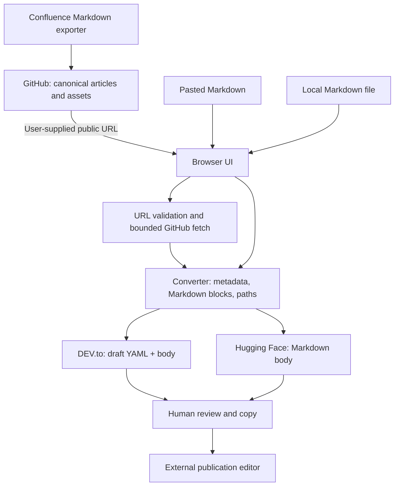

# Architecture — Markdown Publish Bridge v0.2.0

## Purpose

A dependency-free browser application converts Confluence-exported **GitHub Markdown** into manually copied **DEV.to** or **Hugging Face** publication formats. GitHub is the authoritative source; destination copies are generated and reviewed, never silently uploaded.

## Components and ownership

| File | Responsibility | Trust boundary |
| --- | --- | --- |
| `public/index.html` | Accessible form, target tabs, outputs, static CSP | No HTML rendering of user input |
| `public/assets/css/styles.css` | Responsive layout and keyboard focus styling | No external CSS dependencies |
| `public/assets/js/app.js` | UI state, local file import, copy/download and asynchronous GitHub action | DOM uses `.textContent` and `.value` for untrusted strings |
| `public/assets/js/github-source.js` | HTTPS allowlisted, bounded, streaming GitHub Markdown fetch | Reject redirects, credentials, large/invalid content |
| `public/assets/js/converter.js` | Conservative metadata parsing, link rewriting, per-target transformation, warnings | Untrusted Markdown; preserve code and unknown syntax where practical |
| `tests/unit` | Pure converter correctness | Stub-free deterministic tests |
| `tests/integration` | Mock HTTP Response contract | No live GitHub network |
| `tests/security` | Negative inputs and basic policy checks | Test untrusted input behaviour |
| `tests/browser` | Manual-only Playwright browser journeys | Explicit CI exclusion (`SFW-EXC-001`) |
| `scripts` | Offline syntax/structural guards and narrow source/secret checks | Limited rules; not independent SAST |
| `.github/workflows/ci.yml` | PR/push blocking quality and security gates | No deployment privileges, Playwright deliberately absent |

## Security boundaries

1. GitHub source URL: validated against exact GitHub hosts, direct HTTPS only and constrained path segments.
2. Browser network: only raw GitHub Markdown is requested on user action, with `credentials: omit`, `redirect: error`, `referrerPolicy: no-referrer`, 15s abort and a 4 MB streamed body cap.
3. Local content: Markdown and metadata remain in memory; no `localStorage`, telemetry, API keys or automatic publishing.
4. Converter: conservative YAML subset and Markdown transformations with code-fence protection; emits review warnings for unsupported HTML, private attachments and risky links. **No sanitisation or platform preview parity guarantee.**
5. Output: user explicitly copies or downloads Markdown; publishing happens elsewhere under separate site permissions.

See `docs/threat-model.md` for abuse cases and `SECURITY.md` for vulnerability policy.

## Hosting and backwards compatibility

- Host `public/` only; `public/index.html` is the entry point. There is **no build step** and no network-loaded JS libraries.
- v0.1.0 root-level `index.html`, `app.js`, `converter.js`, `styles.css` moved under `public/` and `public/assets/`. Existing converter inputs and destination formats remain compatible.
- Code uses Node-compatible UMD modules so tests require no bundler or transpiler.
- GitHub source refs containing `/` remain unsupported as in v0.1.0. Use a commit permalink or paste the Markdown.
- A restrictive CSP may require HTTP hosting rather than double-clicking local `file://` pages on some browsers; use the documented local preview server.
- Public asset URLs must be anonymously accessible; private repository raw links remain inaccessible to readers.

## Decisions and constraints

- No deployment automation until scoped push/deploy authorisation and appropriate release gates exist.
- SFW Profile **B**, risk **T2** for untrusted parser/public fetch logic; owner sign-off required to release selected T2 changes.
- Playwright exists for local/manual runs but is not an automatic CI gate by explicit project-owner request. The exception and expiry are documented in `docs/engineering/EXCEPTIONS.md`.
- Dependency-free offline guards are a starting baseline rather than a claim of complete SAST/secret/a11y coverage. Outstanding obligations are recorded in the exception register and test plan.
